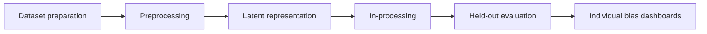

# Healthcare Bias Mitigation

**A Multi-Method Approach Across Diverse Clinical Applications**

Project scope and methodology for a multi-stage healthcare bias-mitigation study.

## Project Scope

The current project phase investigates bias in healthcare prediction through a
**preprocessing -> latent representation -> in-processing** pipeline. It compares
methods for data quality, representation learning, predictive fairness,
calibration and performance across patient groups and hospitals.

The current four-dataset scope is:

| Application | Dataset | Prediction target |
|---|---|---|
| Heart | CDC BRFSS 2022 | Self-reported history of heart attack or coronary heart disease/angina |
| Diabetes | CDC NHANES, August 2021-August 2023 | Self-reported doctor-diagnosed diabetes |
| Hypertension | CDC NHIS 2023 Sample Adult | Self-reported clinician-diagnosed hypertension |
| Respiratory cohort | PhysioNet eICU-CRD v2.0 | In-hospital mortality among eligible ICU stays after the first 24 hours |

Each dataset retains its own population, feature definitions and outcome labels.
Respiratory-cohort mortality is a separate task from disease-diagnosis
classification; the four targets are not treated as one interchangeable label.

The scope includes eight preprocessing bias categories: missing data, class
imbalance, outliers, feature-scale differences, demographic differences,
duplicates, data noise and encoding/domain shift. Latent representations are
evaluated for information preservation, structure, alignment and domain
association. In-processing studies demographic and intersectional fairness,
probability calibration and generalization across hospitals.

Cross-hospital evaluation applies to hospital-identified ICU data. Survey
benchmarks are evaluated separately and do not establish cross-hospital
generalization. Outputs include reproducible code, method comparisons and a
separate interactive dashboard for each bias or latent diagnostic.

This section describes the intended research scope, not a claim that every
method has been implemented or validated. Post-processing and privacy-preserving
or on-device learning remain future extensions beyond this phase.

## Methodology

### 1. Dataset preparation and partitioning

Document each dataset's source, cohort eligibility, predictors, outcome and
available demographic attributes. Define training, validation and test
partitions before fitting transformations. Keep repeated records from the same
patient together where patient identifiers are available. For cross-hospital
experiments, hold out hospitals and check patient overlap between partitions.

### 2. Preprocessing and bias assessment

Assess the eight specified bias categories and compare applicable traditional
and modern methods using the project's method/metric table. Fit imputers,
scalers, encoders and other learned transformations on training data only.
Restrict resampling to training data. Choose methods using predefined validation
criteria and report predictive utility alongside bias-related diagnostics.

Preserve record provenance and distinguish verified data errors from legitimate
clinical variation. An unavailable measure or an unchanged bias signal must not
be reported as successful mitigation.

### 3. Latent representation learning

Compare DGCCA, SAINT and multi-view denoising autoencoder approaches with a PCA
reference. Learn representations from training data, retain dataset-specific
targets and evaluate predictive information using validation probes.

Use Macro-F1 for predictive utility, silhouette for representation structure,
CKA for alignment on justified corresponding observations, and NMI/ARI for
defined clustering/domain comparisons. Shared dimensionality alone does not
establish common clinical meaning; unrelated patient records must not be
treated as paired observations. Document adaptations to the published methods.

### 4. In-processing bias mitigation

Evaluate applicable methods from four families:

| Bias concern | Method families to investigate |
|---|---|
| Demographic prediction dependence | Adversarial fairness, DANN, GroupDRO and fairness-regularized ERM |
| Intersectional/subgroup unfairness | FOMO, intersectional debiasing, fairness-constrained optimization and intersectional GroupDRO |
| Predictive miscalibration | AvUC, correctness ranking loss, uncertainty-weighted gradients and calibration-regularized training |
| Cross-hospital generalization | Fishr, V-REx, EQRM and Fish |

Compare candidates against a common baseline and state any implementation
adaptations or data requirements. Select checkpoints, decision thresholds and
models using validation data; freeze these choices before scoring test or
external data.

### 5. Evaluation and visualization

Report predictive performance, subgroup disparities and probability calibration
together. Metrics include Macro-F1, AUROC, precision-recall measures,
equalized-odds gaps, Brier score and calibration error where applicable. Report
group sample sizes and leave undefined or unsupported comparisons unavailable.

Evaluate hospital-held-out performance only for suitable ICU experiments and
keep survey results separate. Present comparisons in individual interactive
bias dashboards with clear populations, denominators, method labels and
before/after definitions. Report measured trade-offs rather than assuming that
any method guarantees better fairness or generalization.

### Method References

- [Deep Generalized Canonical Correlation Analysis](https://aclanthology.org/W19-4301/)
- [SAINT: official implementation](https://github.com/somepago/saint)
- [Denoising autoencoders: foundational method](https://www.jmlr.org/papers/v11/vincent10a.html)
- [Domain-Adversarial Training of Neural Networks](https://www.jmlr.org/papers/v17/15-239.html)
- [Group Distributionally Robust Optimization](https://arxiv.org/abs/1911.08731)
- [DomainBed: reference domain-generalization implementations](https://github.com/facebookresearch/DomainBed)

These references describe method foundations. Project-specific variants and
evaluation protocols must be documented separately from claims of exact
published-method replication.
