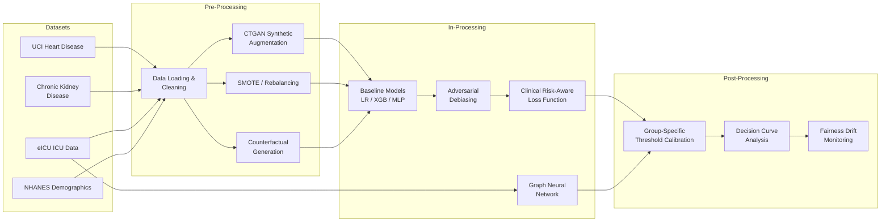

# Data Collection — Clinically Risk-Aware Multi-Stage Bias Mitigation Framework

## 1. Overview

This document describes the **four healthcare datasets** used in our Clinically Risk-Aware, Multi-Stage Bias Mitigation Framework. Each dataset was selected to represent a distinct clinical domain, patient population, and data modality, ensuring our bias mitigation techniques generalise across diverse real-world healthcare scenarios.

### Why Multiple Datasets?

| Rationale | Explanation |
|---|---|
| **Domain diversity** | Heart disease, kidney disease, ICU mortality, and population health — each carries different clinical risks and biases |
| **Demographic coverage** | The datasets collectively cover age, sex/gender, race/ethnicity, and multi-site variation as protected attributes |
| **Data modality variety** | Structured clinical labs, survey-based demographics, multi-table relational ICU data, and single-table diagnostic records |
| **Generalisability proof** | Validating fairness methods across multiple domains demonstrates robustness beyond a single use-case |

---

## 2. Dataset 1 — UCI Heart Disease

### 2.1 Purpose of Collection

The UCI Heart Disease dataset is the **primary benchmark** for evaluating binary classification fairness in cardiovascular risk prediction. It allows us to study **sex-based bias** — historically, heart disease diagnostic models have been trained predominantly on male patients, leading to under-diagnosis in women.

### 2.2 What Does This Dataset Represent?

Each row represents a **single patient visit** with clinical measurements and diagnostic test results from a cardiology evaluation. The target variable (`num`) indicates the presence and severity of heart disease (0 = no disease, 1–4 = increasing severity).

### 2.3 Data Source

| Property | Detail |
|---|---|
| **Source** | UCI Machine Learning Repository |
| **URL** | [https://archive.ics.uci.edu/ml/datasets/Heart+Disease](https://archive.ics.uci.edu/ml/datasets/Heart+Disease) |
| **Original Creators** | Hungarian Institute of Cardiology (Andras Janosi), University Hospital Zurich (William Steinbrunn), University Hospital Basel (Matthias Pfisterer), V.A. Medical Center, Long Beach (Robert Detrano) |
| **Collection Sites** | Cleveland Clinic, Hungarian Institute of Cardiology, University Hospital (Switzerland), Long Beach VA Medical Center |
| **Total Records** | ~920 patients (across all 4 sites) |
| **Year** | 1988 |

### 2.4 Key Parameters (Features)

| Parameter | Type | Description |
|---|---|---|
| `age` | Numeric | Age in years |
| `sex` | Binary | 1 = Male, 0 = Female **(Protected Attribute)** |
| `cp` | Categorical (1–4) | Chest pain type: 1 = typical angina, 2 = atypical angina, 3 = non-anginal, 4 = asymptomatic |
| `trestbps` | Numeric | Resting blood pressure (mm Hg on admission) |
| `chol` | Numeric | Serum cholesterol (mg/dl) |
| `fbs` | Binary | Fasting blood sugar > 120 mg/dl (1 = true, 0 = false) |
| `restecg` | Categorical (0–2) | Resting ECG results: 0 = normal, 1 = ST-T abnormality, 2 = left ventricular hypertrophy |
| `thalach` | Numeric | Maximum heart rate achieved |
| `exang` | Binary | Exercise-induced angina (1 = yes, 0 = no) |
| `oldpeak` | Numeric | ST depression induced by exercise relative to rest |
| `slope` | Categorical (1–3) | Slope of peak exercise ST segment |
| `ca` | Numeric (0–3) | Number of major vessels coloured by fluoroscopy |
| `thal` | Categorical (3,6,7) | Thalassemia: 3 = normal, 6 = fixed defect, 7 = reversible defect |
| `num` (target) | Integer (0–4) | Heart disease diagnosis (binarised to 0/1 for our framework) |

### 2.5 Usage in Pipeline (Training Phase)

```
┌───────────────────────────────────────────────────────────────────────┐
│  PRE-PROCESSING   │  Sex-stratified CTGAN augmentation to balance    │
│                   │  underrepresented female samples.                │
│                   │  SMOTE oversampling as baseline comparison.       │
├───────────────────┼──────────────────────────────────────────────────┤
│  IN-PROCESSING    │  Adversarial debiasing (gradient reversal on     │
│                   │  sex attribute) + Clinical risk-aware loss       │
│                   │  with FN weight = 3.0 (missing heart disease is  │
│                   │  3× worse than false alarm).                     │
├───────────────────┼──────────────────────────────────────────────────┤
│  POST-PROCESSING  │  Group-specific threshold calibration per sex.   │
│                   │  Decision Curve Analysis for clinical utility.   │
│                   │  Continuous SPD/EOD drift monitoring.            │
├───────────────────┼──────────────────────────────────────────────────┤
│  EVALUATION       │  AUC, F1, Recall, Precision per sex group.      │
│                   │  Ablation: single-stage vs. multi-stage.         │
└───────────────────┴──────────────────────────────────────────────────┘
```

### 2.6 Sensitive Attribute Configuration

- **Primary:** `sex` — Male (1, privileged) vs. Female (0, unprivileged)
- **Clinical Severity:** Critical — Cardiovascular (FN weight: 3.0, FP weight: 1.0)

---

## 3. Dataset 2 — Chronic Kidney Disease (CKD)

### 3.1 Purpose of Collection

CKD is a progressive, often silent condition with disparities in diagnosis across age groups. This dataset is used to study **age-based bias** — elderly patients are disproportionately affected by CKD, but models may underperform on them if trained on younger populations. Since the dataset lacks explicit sex or ethnicity columns, it serves as a test case for **fairness with derived protected attributes**.

### 3.2 What Does This Dataset Represent?

Each row represents a **patient's laboratory and clinical profile** evaluated for chronic kidney disease. Features include blood chemistry, urinalysis results, and comorbidity flags. The target indicates whether the patient has CKD or not.

### 3.3 Data Source

| Property | Detail |
|---|---|
| **Source** | UCI Machine Learning Repository |
| **URL** | [https://archive.ics.uci.edu/ml/datasets/Chronic_Kidney_Disease](https://archive.ics.uci.edu/ml/datasets/Chronic_Kidney_Disease) |
| **Creators** | L. Rubini, P. Soundarapandian, P. Eswaran |
| **Institution** | Apollo Hospitals, Managiri, Madurai, Tamil Nadu, India |
| **Total Records** | 400 patients (250 CKD, 150 not-CKD) |
| **Year** | 2015 |
| **Format** | ARFF-like CSV (requires custom parsing) |

### 3.4 Key Parameters (Features)

| Parameter | Type | Description |
|---|---|---|
| `age` | Numeric | Age in years → derived `age_group` **(Protected Attribute)** |
| `bp` | Numeric | Blood pressure (mm Hg) |
| `sg` | Numeric | Specific gravity |
| `al` | Numeric | Albumin level |
| `su` | Numeric | Sugar level |
| `rbc` | Nominal | Red blood cells (normal / abnormal) |
| `pc` | Nominal | Pus cell (normal / abnormal) |
| `pcc` | Nominal | Pus cell clumps (present / not present) |
| `ba` | Nominal | Bacteria (present / not present) |
| `bgr` | Numeric | Blood glucose random (mg/dl) |
| `bu` | Numeric | Blood urea (mg/dl) |
| `sc` | Numeric | Serum creatinine (mg/dl) |
| `sod` | Numeric | Sodium (mEq/L) |
| `pot` | Numeric | Potassium (mEq/L) |
| `hemo` | Numeric | Hemoglobin (g/dl) |
| `pcv` | Numeric | Packed cell volume |
| `wc` | Numeric | White blood cell count (cells/cmm) |
| `rc` | Numeric | Red blood cell count (millions/cmm) |
| `htn` | Nominal | Hypertension (yes / no) |
| `dm` | Nominal | Diabetes mellitus (yes / no) |
| `cad` | Nominal | Coronary artery disease (yes / no) |
| `appet` | Nominal | Appetite (good / poor) |
| `pe` | Nominal | Pedal edema (yes / no) |
| `ane` | Nominal | Anemia (yes / no) |
| `class` (target) | Nominal | CKD class (ckd = 1 / notckd = 0) |

### 3.5 Derived Protected Attribute — `age_group`

Since CKD lacks sex/ethnicity columns, we derive an age-based protected attribute:

| Group | Age Range | Label | Role |
|---|---|---|---|
| Young | ≤ 40 | `young` | Reference |
| Middle | 41 – 60 | `middle` | **Privileged** (best model performance expected) |
| Senior | > 60 | `senior` | **Unprivileged** (higher CKD risk, often under-represented) |

### 3.6 Usage in Pipeline (Training Phase)

```
┌───────────────────────────────────────────────────────────────────────┐
│  PRE-PROCESSING   │  CTGAN augmentation stratified by age_group.     │
│                   │  Counterfactual generation (swap age_group,      │
│                   │  verify prediction stability).                    │
├───────────────────┼──────────────────────────────────────────────────┤
│  IN-PROCESSING    │  Adversarial debiasing on age_group.             │
│                   │  Clinical risk-aware loss: FN weight = 2.5       │
│                   │  (missing CKD → irreversible renal damage).      │
├───────────────────┼──────────────────────────────────────────────────┤
│  POST-PROCESSING  │  Threshold calibration per age_group.            │
│                   │  DCA for clinical net benefit across groups.     │
│                   │  Fairness drift monitoring.                      │
├───────────────────┼──────────────────────────────────────────────────┤
│  EVALUATION       │  Per-group AUC, F1. Counterfactual fairness.    │
└───────────────────┴──────────────────────────────────────────────────┘
```

### 3.7 Sensitive Attribute Configuration

- **Primary:** `age_group` — Middle (privileged) vs. Senior (unprivileged)
- **Clinical Severity:** High — Renal (FN weight: 2.5, FP weight: 1.0)

---

## 4. Dataset 3 — eICU Collaborative Research Database

### 4.1 Purpose of Collection

The eICU dataset represents the **highest-stakes clinical environment** — ICU mortality prediction. It allows us to study **intersectional bias** across both gender and ethnicity simultaneously. Multi-table relational structure (patient ↔ diagnoses ↔ lab results) also enables Graph Neural Network (GNN) modelling to capture patient similarity networks.

### 4.2 What Does This Dataset Represent?

Each row represents a **single ICU stay** for a patient. The dataset contains demographics, admission details, diagnosis codes, and time-series laboratory results. The target variable is **in-hospital mortality** (derived from `hospitaldischargestatus`).

### 4.3 Data Source

| Property | Detail |
|---|---|
| **Source** | eICU Collaborative Research Database (Philips Healthcare) |
| **URL** | [https://eicu-crd.mit.edu/](https://eicu-crd.mit.edu/) / PhysioNet |
| **Reference** | Pollard et al., "The eICU Collaborative Research Database", *Scientific Data*, 2018 |
| **Institutions** | 208 hospitals across the United States (multi-center) |
| **Total Records** | ~200,000+ ICU stays (subset used in our framework) |
| **Tables Used** | `patient.csv`, `diagnosis.csv`, `lab.csv` |
| **Year** | 2014–2015 |

### 4.4 Key Parameters (Features)

#### From `patient.csv` (Demographics & Admission)

| Parameter | Type | Description |
|---|---|---|
| `patientunitstayid` | Integer | Unique ICU stay identifier (merge key) |
| `gender` | Categorical | Male / Female **(Primary Protected Attribute)** |
| `age` | Numeric/String | Age in years ("> 89" capped for privacy → converted to 90) |
| `ethnicity` | Categorical | Race/ethnicity **(Secondary Protected Attribute)** |
| `hospitaldischargestatus` | Categorical | Alive / Expired → **target: mortality (0/1)** |
| `unittype` | Categorical | ICU unit type (e.g., Med-Surg ICU, Cardiac ICU) |
| `apacheadmissiondx` | Text | APACHE admission diagnosis |
| `admissionweight` | Numeric | Weight at admission (kg) |
| `admissionheight` | Numeric | Height at admission (cm) |

#### From `diagnosis.csv` (Derived Features)

| Parameter | Type | Description |
|---|---|---|
| `diagnosis_count` | Numeric | Total number of diagnoses per stay |
| `has_major_diagnosis` | Binary | Contains high-severity diagnosis flag |
| `diagnosis_category` | Categorical | Primary diagnosis category (extracted from `diagnosisstring`) |

#### From `lab.csv` (Derived Features)

| Parameter | Type | Description |
|---|---|---|
| Lab name columns (pivoted) | Numeric | Mean lab result per test per patient (e.g., `glucose`, `creatinine`, `potassium` etc.) |
| Aggregation | Mean/Median | Lab values aggregated across multiple measurements during stay |

### 4.5 Usage in Pipeline (Training Phase)

```
┌───────────────────────────────────────────────────────────────────────┐
│  PRE-PROCESSING   │  Multi-table merge (patient + diagnosis + lab).  │
│                   │  CTGAN augmentation stratified by gender &        │
│                   │  ethnicity jointly. Chunked CSV loading for       │
│                   │  memory efficiency (lab.csv ~26 MB).              │
├───────────────────┼──────────────────────────────────────────────────┤
│  IN-PROCESSING    │  Adversarial debiasing on gender attribute.      │
│                   │  GNN model: patient nodes connected by shared    │
│                   │  diagnoses → captures relational bias patterns.  │
│                   │  Clinical risk-aware loss: FN weight = 4.0       │
│                   │  (missing ICU mortality prediction is highest     │
│                   │  possible stakes).                                │
├───────────────────┼──────────────────────────────────────────────────┤
│  POST-PROCESSING  │  Threshold calibration per gender & ethnicity.   │
│                   │  DCA for clinical utility in ICU decision-making.│
│                   │  Intersectional fairness analysis.               │
├───────────────────┼──────────────────────────────────────────────────┤
│  EVALUATION       │  Per-group AUC, F1, Recall, Precision.          │
│                   │  Intersectional breakdown (gender × ethnicity).  │
└───────────────────┴──────────────────────────────────────────────────┘
```

### 4.6 Sensitive Attribute Configuration

- **Primary:** `gender` — Male (privileged) vs. Female (unprivileged)
- **Secondary:** `ethnicity` — enables intersectional fairness analysis
- **Clinical Severity:** Critical — ICU Mortality (FN weight: 4.0, FP weight: 1.0)

---

## 5. Dataset 4 — NHANES Demographics (2021–2023)

### 5.1 Purpose of Collection

NHANES (National Health and Nutrition Examination Survey) represents a **nationally representative U.S. population** with rich demographic variables. It is used to study **race/ethnicity-based bias** across a broad healthcare context and serves as a demographic validation baseline — ensuring our fairness metrics and rebalancing techniques work on a large, population-level dataset.

### 5.2 What Does This Dataset Represent?

Each row represents a **survey participant** from the NHANES 2021–2023 cycle. The dataset captures self-reported demographic information including age, sex, and detailed race/ethnicity classification, along with household and survey design variables.

### 5.3 Data Source

| Property | Detail |
|---|---|
| **Source** | National Center for Health Statistics (NCHS), CDC |
| **URL** | [https://wwwn.cdc.gov/nchs/nhanes/](https://wwwn.cdc.gov/nchs/nhanes/) |
| **Survey Cycle** | 2021–2023 |
| **Scope** | Nationally representative sample of the U.S. civilian, non-institutionalised population |
| **Original Format** | SAS Transport (.XPT) → Converted to CSV |
| **Total Records** | ~15,000+ participants |

### 5.4 Key Parameters (Features)

| Parameter | Code | Type | Description |
|---|---|---|---|
| Participant ID | `SEQN` | Integer | Unique participant identifier |
| Gender | `RIAGENDR` | Categorical (1/2) | 1 = Male, 2 = Female **(Primary Protected Attribute)** |
| Age | `RIDAGEYR` | Numeric | Age in years at screening |
| Race/Ethnicity (v1) | `RIDRETH1` | Categorical (1–5) | 5-category race/ethnicity recode |
| Race/Ethnicity (v3) | `RIDRETH3` | Categorical (1–7) | 7-category race/ethnicity recode **(Secondary Protected Attribute)** |
| Interview Status | `RIDSTATR` | Categorical | 1 = Interviewed only, 2 = Interviewed and examined |
| Country of Birth | `DMDBORN4` | Categorical | 1 = Born in US, 2 = Born outside US |
| Education Level | `DMDEDUC2` | Categorical | Education level (adults 20+) |
| Marital Status | `DMDMARTZ` | Categorical | Marital status |
| Household Size | `DMDHHSIZ` | Numeric | Total number of people in household |
| Annual Income | `INDHHIN2` | Categorical | Annual household income ranges |

### 5.5 Race/Ethnicity Code Mapping (`RIDRETH3`)

| Code | Label |
|---|---|
| 1 | Mexican American |
| 2 | Other Hispanic |
| 3 | Non-Hispanic White |
| 4 | Non-Hispanic Black |
| 5 | Other / Multi-Racial |
| 6 | Non-Hispanic Asian |
| 7 | Other / Multi-Racial |

### 5.6 Usage in Pipeline (Training Phase)

```
┌───────────────────────────────────────────────────────────────────────┐
│  PRE-PROCESSING   │  Demographic distribution analysis baseline.     │
│                   │  CTGAN augmentation to generate synthetic        │
│                   │  records for underrepresented race/ethnicity     │
│                   │  groups. Age-group derivation (young/middle/     │
│                   │  senior).                                         │
├───────────────────┼──────────────────────────────────────────────────┤
│  IN-PROCESSING    │  Adversarial debiasing on gender and ethnicity.  │
│                   │  Population-weighted fairness constraints.       │
├───────────────────┼──────────────────────────────────────────────────┤
│  POST-PROCESSING  │  Multi-group threshold calibration (across 6+   │
│                   │  race/ethnicity groups). Disparate Impact Ratio  │
│                   │  per demographic subgroup. Fairness drift        │
│                   │  monitoring.                                      │
├───────────────────┼──────────────────────────────────────────────────┤
│  EVALUATION       │  Cross-demographic performance validation.       │
│                   │  Population representativeness checks.           │
└───────────────────┴──────────────────────────────────────────────────┘
```

### 5.7 Sensitive Attribute Configuration

- **Primary:** `RIAGENDR` — Male (1, privileged) vs. Female (2, unprivileged)
- **Secondary:** `RIDRETH3` — 7-category race/ethnicity

---

## 6. Summary — Datasets at a Glance

| Property | UCI Heart Disease | CKD | eICU | NHANES |
|---|---|---|---|---|
| **Clinical Domain** | Cardiovascular | Renal | ICU Critical Care | Population Health |
| **Records** | ~920 | 400 | ~200,000+ | ~15,000+ |
| **Target Variable** | Heart disease (0/1) | CKD (ckd/notckd) | ICU Mortality (0/1) | N/A (demographic baseline) |
| **Primary Protected Attr.** | `sex` | `age_group` (derived) | `gender` | `RIAGENDR` |
| **Secondary Protected Attr.** | — | — | `ethnicity` | `RIDRETH3` |
| **Clinical Severity** | Critical (FN=3.0×) | High (FN=2.5×) | Critical (FN=4.0×) | — |
| **Data Modality** | Single table | Single table | Multi-table relational | Single table (survey) |
| **Source** | UCI Repository | UCI Repository | PhysioNet / Philips | CDC / NCHS |
| **Year** | 1988 | 2015 | 2014–2015 | 2021–2023 |

---

## 7. How Datasets Map to Framework Stages



---

## 8. Files Implementing Data Collection

| File | Purpose |
|---|---|
| [`config.py`](file:///C:/Users/U%20SRIYA/Documents/Data_Set/config.py) | Central configuration: dataset paths, column definitions, sensitive attributes, clinical severity weights |
| [`data_loader.py`](file:///C:/Users/U%20SRIYA/Documents/Data_Set/data_loader.py) | Unified data loaders for all 4 datasets: `load_heart_disease()`, `load_ckd()`, `load_eicu()`, `load_nhanes()` |
| [`requirements.txt`](file:///C:/Users/U%20SRIYA/Documents/Data_Set/requirements.txt) | Python dependencies (pandas, scikit-learn, torch, sdv, aif360, etc.) |

---

*Document generated for the Clinically Risk-Aware Multi-Stage Bias Mitigation Framework.*
